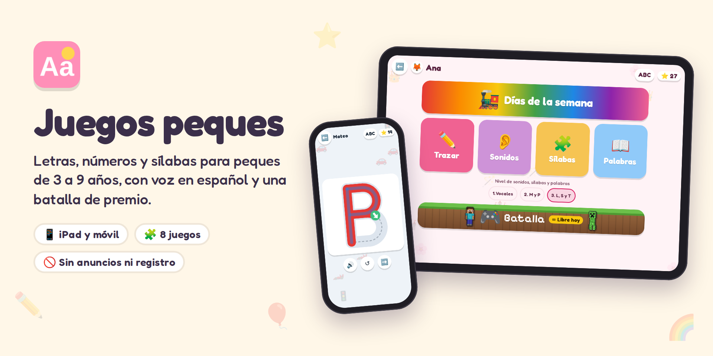
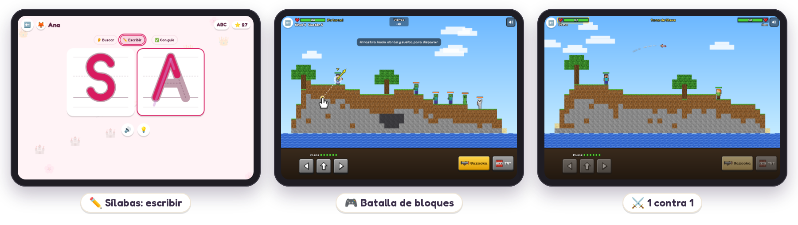
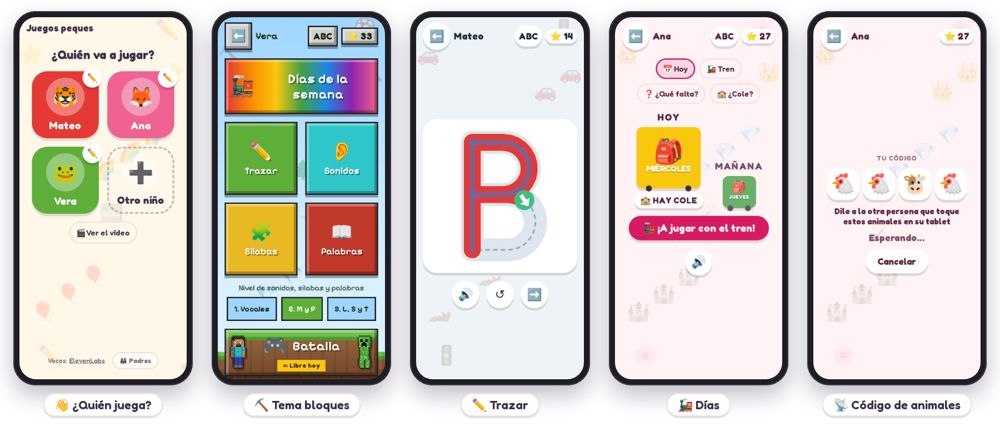

<h1 align="center">
  
</h1>

<p align="center"><b>Aprender letras, números y sílabas jugando, con voz en español.</b></p>

<p align="center">
  <a href="https://bernardopersonal.github.io/juegos-peques-es/"></a>
</p>

<p align="center">
  <a href="LICENSE"></a>
  <a href="LICENSE-CONTENIDO.md"></a>
  
  
  
</p>

> **English summary.** *Juegos peques* is a set of educational games in Spanish (from Spain) for
> children aged 3 to 9: tracing numbers and letters, counting, colours, letter sounds, syllables, words
> and the days of the week, all with recorded voice (generated with ElevenLabs), plus a play in English
> (*The Three Little Pigs*) where the child learns the wolf's lines with a British or American accent:
> listen, repeat, record yourself and blow into the microphone to knock the houses down. Stars earned while
> learning unlock a block-world battle game, with a 1-vs-1 mode on the same tablet or over the network.
> It is a static web app (HTML, CSS and plain JavaScript, no libraries, plus a small PHP file for the
> network mode) that runs on iPad, phones and computers. Progress stays on the device (optionally, with an
> end-to-end encrypted backup on your own hosting, behind a password): no accounts, no ads, no analytics.
> Code under MIT; audio, video, icons and screenshots under CC BY-NC 4.0.
> [Play the demo](https://bernardopersonal.github.io/juegos-peques-es/).

## Qué es

Juegos para tablet o móvil, con tarjetas grandes para dedos pequeños y una voz en español de España
que lo explica todo, así que se puede jugar sin saber leer. Cada niño crea su perfil (nombre, edad, foto
o dibujo y tema) y ve los juegos de su edad. Con las estrellas que gana aprendiendo desbloquea partidas
de la **Batalla de bloques**.

<p align="center">
  
</p>
<p align="center">
  
</p>

Temas: unicornios, princesas, divertido, fútbol, espacio, coches, bloques (pixelado) y dinosaurios.
El botón **ABC** cambia entre mayúsculas, minúsculas y mixto, y **🎬 Ver el vídeo** pone un vídeo de
presentación narrado.

## Juegos según la edad

| Edad | Juegos |
|---|---|
| **Peques** (hasta 4 años) | ✏️ Trazar · 🔢 Contar · 🎨 Colores · 🔤 Letras |
| **Mayores** (5 años o más) | 🚂 Días de la semana · 🐺 Teatro en inglés · ✏️ Trazar · 👂 Sonidos · 🧩 Sílabas · 📖 Palabras |
| **Todos**, de premio | 🎮 Batalla de bloques |

| Juego | Qué se hace |
|---|---|
| ✏️ **Trazar** | Números del 0 al 9 y letras (A-Z y Ñ) con el dedo, siguiendo la bolita verde y la flecha. |
| 🔢 **Contar** | Toca cada dibujo para contarlo en voz alta y elige cuántos hay (1-5). |
| 🎨 **Colores** | «Toca el rojo»: elige entre tres manchas de color. |
| 🔤 **Letras** | «¿Dónde está la eme?»: elige entre tres letras. |
| 👂 **Sonidos** | Ve un dibujo, oye «¿Con qué sonido empieza oso?» y toca la letra. |
| 🧩 **Sílabas** | *Buscar:* oye «Busca: ma» y elige la sílaba. *Escribir:* oye «Escribe: mo» y traza la M y la O, con guía o sin ella. |
| 📖 **Palabras** | Ordena las sílabas del dibujo: PA + TO. |
| 🚂 **Días de la semana** | Hoy y mañana, el tren de la semana, «¿Qué falta?» y «¿Hay cole?». Con vuestra rutina, también «¿Qué toca?». |
| 🐺 **Teatro en inglés** | Aprende las frases del lobo de *The Three Little Pigs*, con acento británico o americano. *Escuchar:* el cerdito, el lobo y el karaoke, frase a frase; 🐢 despacio y a trozos; 🎤 se graba y se oye junto al lobo; y sopla al micro (o toca muchas veces 💨) para tirar las casas. *Ensayo:* la obra entera, con apuntador. *¿Qué viene?:* elige qué dice ahora el lobo. |

Sonidos, Sílabas y Palabras tienen 3 niveles: vocales; M y P; L, S y T.

## Batalla de bloques

Un juego por turnos en un mundo de bloques. Con Steve o con Alex, se lanza el bazooka o la TNT como con
un tirachinas (arrastrar hacia atrás y soltar), con viento, contra zombis, creepers y esqueletos. El
suelo se agrieta y se rompe hasta el agua. Cada nivel ganado abre el siguiente, y los peques juegan en
modo fácil: los monstruos no hacen daño y se ve la trayectoria entera.

- **Se gana aprendiendo:** cada 5 ⭐ de los juegos = 1 partida. Ganar en la Batalla no da estrellas.
- **👪 Padres:** con una multiplicación de candado, regalar 1 o 3 partidas o dejarlo libre hoy (y, en tu
  hosting, la copia en la nube: más abajo).
- **⚔️ 1 contra 1:** Steve contra Alex, sin monstruos.
  - **📱 En esta tablet:** se pasan el iPad por turnos.
  - **📡 En red:** uno crea la partida y le sale un código de 4 animales; el otro lo toca en su tablet
    para unirse. Necesita el servidor PHP (`api/sala.php`): en la demo de GitHub Pages sale «no
    disponible», y en esta tablet funciona igual.

### Controles

| | Dedo o ratón | Teclado |
|---|---|---|
| Andar | ◀ ▶ (mantener para seguir) | ← → o A D (mantener para seguir) |
| Saltar | ⇧ | ↑ o W |
| Arma | Bazooka · TNT | 1 · 2 |
| Apuntar y disparar | Arrastrar hacia atrás y soltar | Con el dedo o el ratón |

Las letras valen también por su sitio en el teclado (en uno francés, Q y D andan y Z salta). El
teclado solo funciona en tu turno y sin ningún aviso abierto. Los juegos de aprender son de tocar y
trazar, con el dedo o con el ratón.

## Con tus propios niños

De serie no hay ningún niño: cada uno se crea su perfil y la voz le habla sin nombre («¡Muy bien!»).
Para que la voz diga su nombre y conozca vuestra semana:

1. **Edita `js/familia.js`.** Viene vacío y con un ejemplo comentado (niños y actividades inventados):
   - `perfiles`: los niños con voz propia («¡Hola, Ana! ¡Bienvenida!»);
   - `rutina`: qué toca cada día, para «¿Qué toca?» en Días de la semana;
   - `videoDias` (opcional): un vídeo de los días con vuestra rutina (`npm run video:dias`).
2. **Genera los audios con tu propia clave de ElevenLabs.** Cada familia usa la suya:

   ```bash
   cp .env.example .env      # pon tu ELEVENLABS_API_KEY y ELEVENLABS_VOICE_ID (.env no se sube nunca)
   npm run voces             # voces en español para elegir
   npm run audios:simular    # cuántas frases y caracteres faltan, sin gastar nada
   npm run audios            # genera solo las que faltan: los nombres y las preguntas de la rutina
   ```

   O en GitHub, sin instalar nada: Secret `ELEVENLABS_API_KEY`, variable `ELEVENLABS_VOICE_ID` y
   Actions → **Generar audios (ElevenLabs)** → *Run workflow*.

Todas las demás frases ya vienen grabadas y, mientras falte alguna, la dice la voz del navegador. Las
voces en inglés del Teatro también vienen hechas (`audio/teatro/`); si cambias su guion
(`js/teatro-guion.js`), `npm run teatro:simular` dice lo que falta y `npm run teatro` lo genera
(`scripts/generar-teatro.mjs`), o en GitHub: Actions → **Generar voces del teatro (inglés)**. El plan
gratuito de ElevenLabs es para uso no comercial y pide citar a elevenlabs.io (la app lo hace en el
inicio). **La clave nunca va en el código:** mejor una solo para este proyecto, con permiso únicamente
de *Text to Speech* y con límite de créditos. Las palabras, sílabas y frases están en `js/contenido.js`.

## Privacidad

| Qué | Dónde queda |
|---|---|
| Perfiles (nombre, edad, foto o dibujo, tema), estrellas y progreso | En el aparato, en el almacenamiento del navegador (`localStorage`). La foto se recorta a 256 px. No hay cuentas. Sin la copia en la nube, no se sube a ningún sitio. |
| Copia en la nube (opcional, en tu hosting) | En **👪 Padres**: se cifra en el aparato (AES-256-GCM) con un código de familia de 5 palabras que no sale de él, y el servidor (`api/copia.php`) solo guarda el texto cifrado. Con el código se recupera en otro aparato y las tablets se mantienen al día. Solo funciona con la contraseña de la web puesta. Todo el detalle, en [docs/PUERTA-Y-COPIA.md](docs/PUERTA-Y-COPIA.md). |
| 1 contra 1 en red | Por la red solo van el héroe (Steve o Alex), las jugadas y el estado del mapa. Nunca el nombre, la edad ni la foto. |
| Micrófono del Teatro | Solo se abre al tocar 🎤 o 💨, y se apaga en cuanto acaba. La grabación se queda en la memoria del navegador mientras se juega: no se guarda ni se sube, y se borra al salir del Teatro. |
| El servidor (`api/sala.php`) | Archivos en `api/datos/`, sin base de datos: la sala y sus mensajes (se borran cuando salen los dos o a las 3 h sin actividad) y el código de animales (caduca a los 15 min). Para frenar a quien pruebe códigos, guarda una huella de la IP con una clave que cambia cada hora, nunca la IP. Todo el detalle, en [docs/DUELO.md](docs/DUELO.md#privacidad-los-jugadores-son-niños). |
| Terceros | Solo Google Fonts: el navegador pide las fuentes a fonts.googleapis.com y fonts.gstatic.com, así que Google ve la IP. Si no lo quieres, sírvelas desde tu web y cambia el `<link>` de `index.html`. |

Sin analítica y sin anuncios. Cookies, solo las de la contraseña de la web, si la pones (no son de
seguimiento). Las voces son MP3 que se sirven desde tu web: al jugar no se llama a ElevenLabs. Como cualquier web, el hosting (también GitHub Pages) apunta las visitas en sus
registros.

## Probarlo en tu ordenador

No hace falta instalar nada: abre `index.html` en el navegador y funciona todo menos el 1 contra 1 en
red. Para probarlo en la tablet, o con el modo en red (PHP 7.4 o más):

```bash
python3 -m http.server 8080   # sin PHP (o npm start): http://localhost:8080
php -S 127.0.0.1:8080 -t .    # con el 1 contra 1 en red: dos pestañas, una crea y la otra se une
php -S 0.0.0.0:8080 -t .      # desde la tablet, en la misma wifi: http://IP-de-tu-ordenador:8080
```

## Publicarlo

- **GitHub Pages** (gratis, sin PHP): [`.github/workflows/publicar.yml`](.github/workflows/publicar.yml)
  sube la web sin los scripts (de `api/` solo va `sala.php`, que allí no se ejecuta: el 1 contra 1 en
  red sale «no disponible»). Actívalo en Settings → Pages → Source: *GitHub Actions*. En este repo se
  publica solo con cada push a `main`; en un fork, lánzalo a mano (Actions → *Publicar en GitHub Pages* →
  *Run workflow*) o pon el nombre de tu repo en su `if:`. Desde un repo privado no publica nunca.
- **Tu hosting con PHP 7.4 o más**, para jugar en red: qué subir por FTP (y qué no), permisos y la
  limpieza programada, en [docs/DUELO.md, sección F](docs/DUELO.md#f-despliegue-por-ftp-con-filezilla).
- **Ponle contraseña** si es para tu familia (`api/puerta.php`; necesita Apache con mod_rewrite): sin
  ella, cualquiera con la dirección ve la web, también los audios con los nombres de tus niños si los has
  generado, y la copia en la nube no funciona. Se configura desde el navegador con un archivo que solo
  puede crear quien entra por FTP: [docs/PUERTA-Y-COPIA.md](docs/PUERTA-Y-COPIA.md). Y mejor en su
  propio dominio o subdominio, sin otras webs al lado (lo guardado en el navegador es de todo el dominio).
- En cada despliegue, cambia el `?v=` de `index.html` (el mismo en todas sus apariciones): así un
  `index.html` nuevo nunca se junta con un `.js` viejo de la caché.
- En el iPad: Compartir → **Añadir a pantalla de inicio**, y se abre a pantalla completa como una app.

## Por dentro

Una sola página, sin librerías ni paso de compilación. Canvas 2D a mano para trazar, para la Batalla y
para el escenario del Teatro, sonidos 8-bit sintetizados con Web Audio, y PHP sin base de datos para el
modo en red. La música del vídeo también sale de código (`video/musica.mjs`).

```
index.html            la web (una sola página)
css/estilos.css
js/familia.js         ← tus niños y vuestra rutina (vacío, con un ejemplo)
js/contenido.js       ← palabras, sílabas, frases y niveles
js/app.js             los juegos
js/teatro.js          el Teatro en inglés; teatro-escena.js (el escenario pixelado) y teatro-guion.js (las frases)
js/trazos.js          forma y orden de los trazos de cada número y letra
js/frases.js          reproduce los MP3 (o usa la voz del navegador si falta alguno)
js/temas.js           colores y decoración de cada tema
js/minijuegos/        Batalla de bloques: motor, dibujos, sonidos 8-bit y red
js/nube.js            la copia en la nube, cifrada en el aparato
api/sala.php          servidor del 1 contra 1 en red (PHP 7.4 a 8.x); guarda en api/datos/
api/puerta.php        la contraseña de la web (con el .htaccess de la raíz)
api/copia.php         donde se guarda la copia en la nube (cifrada)
audio/                los MP3 de las frases + manifest.js
audio/teatro/         las voces en inglés del Teatro (gb/, us/) + manifest.js, con el momento de cada palabra
media/                el vídeo de presentación
video/                escena, música y montaje del vídeo; narración en video/narracion/
scripts/              generar audios (y las voces del Teatro), elegir voz y hacer los vídeos (Node 18 o más)
docs/DUELO.md         el 1 contra 1: cómo funciona, privacidad y despliegue por FTP
docs/PUERTA-Y-COPIA.md la contraseña de la web y la copia en la nube: uso, seguridad y privacidad
.github/workflows/    generar audios, las voces del Teatro, hacer el vídeo y publicar en GitHub Pages
```

## Licencias

| Qué | Licencia |
|---|---|
| Código: HTML, CSS, JavaScript, PHP, scripts `.mjs` y workflows | MIT: [LICENSE](LICENSE) |
| Contenido: `audio/`, `media/`, `video/narracion/`, los iconos y las capturas (`docs/capturas/`) | CC BY-NC 4.0: [LICENSE-CONTENIDO.md](LICENSE-CONTENIDO.md) |
| La fuente Pixelify Sans de `video/fuentes/` (para el vídeo) | SIL Open Font License 1.1: [video/fuentes/OFL.txt](video/fuentes/OFL.txt) |

© 2026 [bernardopersonal](https://github.com/bernardopersonal). El contenido es no comercial porque las
voces salen del plan gratuito de ElevenLabs.

## Créditos

- **Voces generadas con ElevenLabs ([elevenlabs.io](https://elevenlabs.io)).**
- Fuentes [Fredoka](https://fonts.google.com/specimen/Fredoka) y
  [Pixelify Sans](https://fonts.google.com/specimen/Pixelify+Sans), con la SIL Open Font License,
  servidas por Google Fonts. La copia de Pixelify Sans que usa el vídeo lleva su licencia en
  [video/fuentes/OFL.txt](video/fuentes/OFL.txt).
- Dibujos, sonidos y música: hechos con código, en este repositorio.

**Aviso:** Juegos peques es un proyecto de fans no oficial. No está afiliado a Mojang ni a Microsoft, ni
cuenta con su aprobación. «Minecraft» es una marca de Microsoft. Los dibujos de la Batalla de bloques son
pixel-art propio hecho con código (`js/minijuegos/sprites.js`): no se usa ninguna imagen ni ningún sonido
del juego original.
